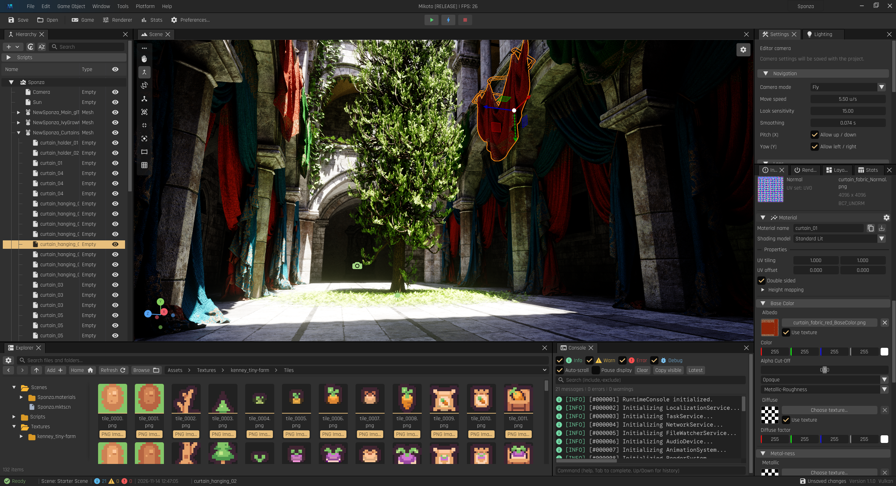
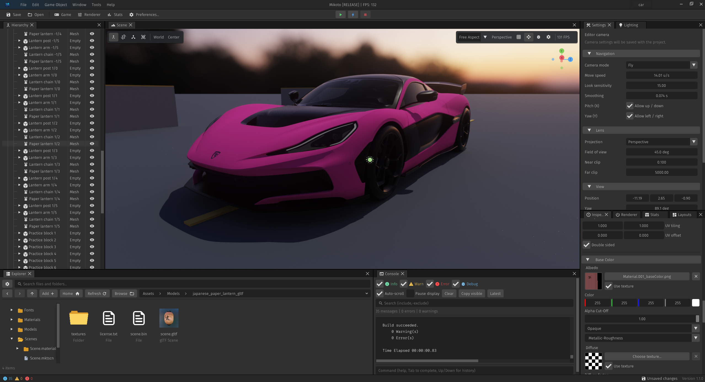
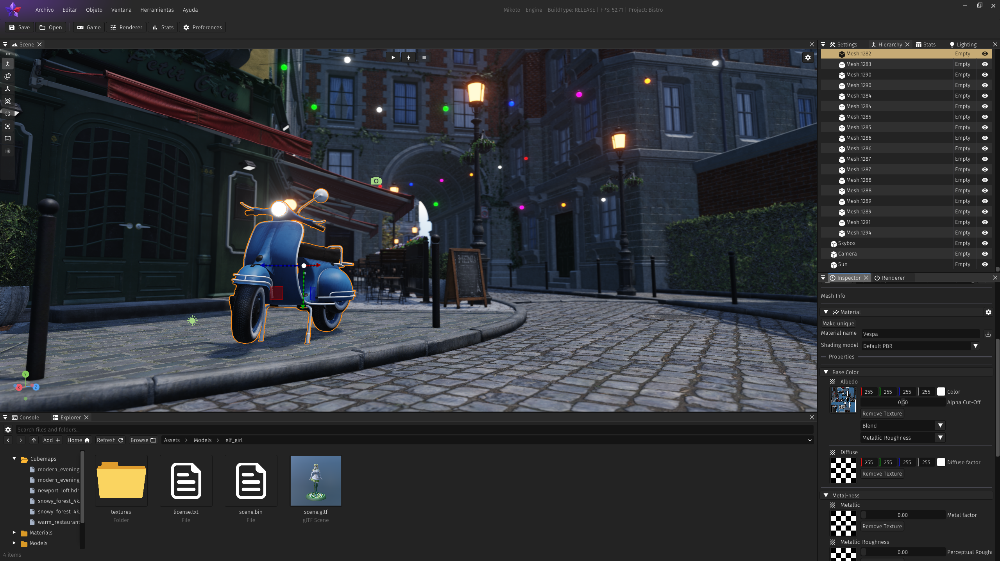
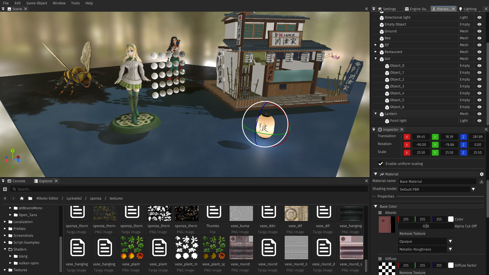
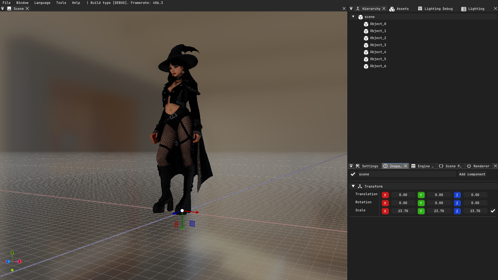

# Mikoto Engine

[](https://www.codefactor.io/repository/github/katebea/mikoto)
[](LICENSE)

Mikoto is open-source engine I have been working on since 2023. I started the project after I finished my first renderer following the [LearnOpenGL](https://learnopengl.com/) set of articles.

It is written in C++20 and serves as foundation for me to keep exploring graphics programming techniques and software architecture and development. It supports Vulkan and Direct3D 12 as part of the rendering backend
through an RHI layer (Render Hardware Interface). Support for OpenGL and D3D11 implementations are experimental through the same interfaceand but not any close to what Vulkan and D3D12 have to offer.



<details>
<summary>More screenshots</summary>










</details>

## Features

Some of the features availables include:

**Core**

* **Entity Component System:** Scene and game object management with [skypjack/entt](https://github.com/skypjack/entt).
* **3D Model Loading:** glTF support through [spnda/fastgltf](https://github.com/spnda/fastgltf), with [assimp/assimp](https://github.com/assimp/assimp) used for support for other formats.
* **Image Loading:** Texture and image loading through [nothings/stb](https://github.com/nothings/stb), with KTX texture support through [KhronosGroup/KTX-Software](https://github.com/KhronosGroup/KTX-Software).
* **HDR & Environment Maps:** HDR image loading also with `stb_image`, with equirectangular-to-cubemap conversion.
* **Physics:** Rigid-body physics, collision handling, and vehicle constraint with [jrouwe/JoltPhysics](https://github.com/jrouwe/JoltPhysics).
* **Audio:** Audio playback and mixing through [mackron/miniaudio](https://github.com/mackron/miniaudio), with spatial audio through [ValveSoftware/steam-audio](https://github.com/ValveSoftware/steam-audio).
* **Scripting:** Lua scripting through [ThePhD/sol2](https://github.com/ThePhD/sol2) and C# scripting through .NET hosting (scripting with C++ planned for later).
* **Skeletal Animation:** Animation playback, blending, controllers, and inverse kinematics through [guillaumeblanc/ozz-animation](https://github.com/guillaumeblanc/ozz-animation).
* **Runtime Canvas UI:** Hierarchical canvas widgets with buttons, toggles, sliders, sprites, and text, including input handling.
* **Video Playback:** Experimental H.264 playback through Vulkan Video, with MP4 demuxing through [lieff/minimp4](https://github.com/lieff/minimp4) and synchronized audio playback.

**Rendering**

* **Vulkan & Direct3D 12:** Rendering backends behind a shared RHI and frame graph. Support for OpenGL and D3D11 is experimental as they do not fit well in the frame graph yet.
* **Shader Compilation & Caching:** [shader-slang/slang](https://github.com/shader-slang/slang) compilation with a shader-library cache for compiled SPIR-V and DXIL.
* **Clustered Forward+:** Physically based shading with clustered lighting, light culling, instancing, and GPU indirect drawing.
* **Ray Tracing & Path Tracing:** Hardware ray-traced shadows, reflections, GI, and AO, plus progressive path tracing with temporal accumulation and depth of field, following [PBRT](https://pbr-book.org/4ed/).
* **Lighting & Shadows:** Point, spot, and directional lights, cascaded shadows, optional raster soft shadows, and path-traced mesh and rectangular area lights.
* **Material Models:** Metallic/roughness PBR, dielectric and conductor materials, and subsurface scattering, with editable optical properties.
* **Height Mapping:** Bump, parallax, and displacement mapping with material controls.
* **HDR & Atmospheric Scattering:** HDR rendering, image-based lighting, skyboxes, and experimental atmospheric scattering with aerial perspective.
* **Post Processing:** Bloom, tone mapping, SSAO, depth of field, vignette, film grain, and composable post-process materials.
* **Terrain:** Experimental heightmap terrain with GPU geometry generation, procedural noise, and landscape import and preview tools.
* **Particles:** Configurable emitters with CPU or experimental GPU simulation, playback controls, and reusable particle assets.
* **Infinite Grid:** Procedural editor/world grid.
* **Text Rendering:** MSDF text through [Chlumsky/msdfgen](https://github.com/Chlumsky/msdfgen) and experimental Slug text through [AlphaPixel/slughorn](https://github.com/AlphaPixel/slughorn), with Unicode and colour emoji support.

**Editor**

* **ImGui Integration:** Dockable editor panels through [ocornut/imgui](https://github.com/ocornut/imgui), with separate Scene and Game views and play/pause/simulation controls.
* **Transform Gizmos:** Move, rotate, and scale tools through [CedricGuillemet/ImGuizmo](https://github.com/CedricGuillemet/ImGuizmo), with smooth camera transitions and orbit/free-fly navigation.
* **Viewport Selection & Drag-and-Drop:** Object picking, visible rectangle selection, and texture/material drops onto scene meshes or environments.
* **Asset & Material Tools:** Content browser thumbnails, material previews and persistence, prefab workflows, and asset hot reloading.
* **Animation & Debug Views:** Animation graph and timeline tools, armature overlays, and rendering debug views including SSAO.
* **Profiling:** Performance plots through [epezent/implot](https://github.com/epezent/implot) and optional CPU/GPU profiling through [wolfpld/tracy](https://github.com/wolfpld/tracy).

For a complete list of third-party libraries and how they are used throughout the engine, see the **[Third-Party Libraries](THIRD_PARTY.md)** page. See [FEATURE.md](FEATURE.md) for the detailed feature checklist and roadmap.

## **Platform Support**

Mikoto is currently developed and tested on **Windows** and **Ubuntu 24.04 LTS**.
The primary development toolchains are **MSVC** on Windows and **GCC 13.3.0** on Linux.

| Platform        | Architecture | Compiler | CMake Generator      | Rendering API       |
|-----------------|--------------|----------|----------------------|---------------------|
| **Windows 10+** | x86_64       | MSVC     | Visual Studio, Ninja | Vulkan, Direct3D 12 |
| **Linux**       | x86_64       | GCC      | Ninja, Make          | Vulkan              |

Other distributions, architectures, compilers, and build generators may be supported, but have not been tested.

## Building

For package installation commands, vcpkg setup, and IDE-specific instructions, see [BUILDING.md](BUILDING.md).

### Requirements

| Requirement        | Windows x64                                                                               | Ubuntu 24.04 LTS x64                                     |
|--------------------|-------------------------------------------------------------------------------------------|----------------------------------------------------------|
| C++ compiler       | Visual Studio 2022 or newer with Desktop development with C++                             | GCC 13 / G++ 13                                          |
| Build tools        | CMake **3.30+**, Git                                                                      | CMake **3.30+**, Git                                     |
| Graphics           | Vulkan SDK and an up-to-date GPU driver for developement; <br/>Vulkan or D3D12 at runtime | Vulkan development packages and a compatible GPU driver  |
| C# scripting       | .NET **10 SDK**, including the native hosting pack                                        | .NET **10 SDK**, including the native hosting pack       |
| Dependency manager | vcpkg recommended; CMake/FetchContent fallback available                                  | vcpkg recommended; CMake/FetchContent fallback available |

The editor currently enables C# support unconditionally, so the .NET SDK is required even if your project only uses Lua. A runtime-only installation is not sufficient to build the editor.

The first configure downloads and prepares third-party dependencies and can take substantially longer than later builds. vcpkg does not replace the platform prerequisites above.

### Windows

Install the [Windows prerequisites](BUILDING.md#windows-prerequisites), then open an **x64 Visual Studio Developer PowerShell** so that `cl`, the Windows SDK, CMake, and Ninja are available.

```powershell
git clone https://github.com/kateBea/Mikoto.git
Set-Location Mikoto

cmake --preset windows-release
cmake --build --preset windows-release --parallel 4

Set-Location out/build/windows-release/Mikoto-Editor
.\MikotoEditor.exe
```

For Debug, replace `windows-release` with `windows-debug` in both commands and the output path.

**CLion:** select the Visual Studio toolchain with **x64** architecture and the **Windows release (automatic dependencies)** profile. The preset does not select CLion's toolchain for you; MinGW is not supported by the Windows build. See [Running from an IDE](BUILDING.md#running-from-an-ide).

### Ubuntu 24.04 LTS

First follow the [Ubuntu setup](BUILDING.md#ubuntu-2404-lts-prerequisites) to install the system development packages, .NET SDK, and CMake 3.30 or newer. Ubuntu 24.04's original CMake package is too old for this project.

```bash
git clone https://github.com/kateBea/Mikoto.git
cd Mikoto

cmake --preset linux-release -DCMAKE_C_COMPILER=gcc-13 -DCMAKE_CXX_COMPILER=g++-13
cmake --build --preset linux-release --parallel 4

cd build/linux-release/Mikoto-Editor
```

You can change graphics API by editing the existing `[renderer]` section in the copied `app-config.toml`:

```toml
[renderer]
api = "vulkan" # ogl(OpenGL), d3d11(Direc2D 11), d3d12(Direct3D 12)
```

Then run:

```bash
./MikotoEditor
```

The checked-in configuration currently selects Vulkan. Do not add a duplicate `[renderer]` section. For Debug, use `linux-debug` in place of `linux-release`.

### Choosing a dependency provider

The default `AUTO` provider uses vcpkg when it can find a valid installation; otherwise, it uses the CMake/FetchContent dependencies. Set `VCPKG_ROOT` to your vcpkg installation before configuring. Manifest dependencies are installed automatically from [vcpkg.json](vcpkg.json).

| Preset                                            | Configuration | Dependencies        |
|---------------------------------------------------|---------------|---------------------|
| `windows-release` / `linux-release`               | Release       | Automatic selection |
| `windows-debug` / `linux-debug`                   | Debug         | Automatic selection |
| `windows-source-release` / `linux-source-release` | Release       | CMake/FetchContent  |

For example, to explicitly use FetchContent on Windows:

```powershell
cmake --preset windows-source-release
cmake --build --preset windows-source-release --parallel 4
```

To require vcpkg, pass `-DMIKOTO_DEPENDENCY_PROVIDER=VCPKG` during the first configure. Automatic fallback applies only when vcpkg is unavailable; a failed package build remains an error so its cause can be fixed.

Use a fresh build directory when changing dependency provider, compiler, or triplet. The provided vcpkg triplets select Mikoto's library and runtime linkage; standard `x64-windows` packages are not interchangeable with the project's static MSVC runtime configuration.

## Configuration

Run the editor with `build/PRESET/Mikoto-Editor` as its **working directory**. The build copies `app-config.toml` and runtime resources there. Keep the staged files with the executable.

- **Rendering API:** edit `renderer.api` in `app-config.toml` to select `"vulkan"` or, on Windows, `"d3d12"`.
- **Rendering quality:** use the editor's Renderer settings for resolution, MSAA, tone mapping, and ray-tracing options.
- **Scripts:** choose Lua or C# in a Script component. C# scripts are compiled by the editor; you do not need to maintain a separate script `.csproj`.

For a persistent local configuration change, edit [Mikoto/Resources/app-config.toml](Mikoto/Resources/app-config.toml). With every build
this file gets copied and replaced to the build directory.

## Dependencies

Third-party libraries and their roles are listed in [THIRD_PARTY.md](THIRD_PARTY.md). Dependency declarations are split between two supported build paths:

| Location                                                        | Purpose                                             |
|-----------------------------------------------------------------|-----------------------------------------------------|
| [vcpkg.json](vcpkg.json)                                        | Manifest packages, features, and pinned versions    |
| [CMake/Ports](CMake/Ports) and [CMake/Triplets](CMake/Triplets) | Package customizations and platform build settings  |
| `Mikoto/Module_Name/Dependencies.cmake`                            | Package lookup, FetchContent fallback, and module linkage |

When adding a library, update both dependency paths and link it to the module that uses it. See [Dependency layout and adding a library](BUILDING.md#dependency-layout-and-adding-a-library) for a worked example.

## Repository layout

| Directory                            | Contents                                                                         |
|--------------------------------------|----------------------------------------------------------------------------------|
| [Mikoto](Mikoto)                     | Engine modules: rendering, scenes, assets, scripting, physics, and other systems |
| [Mikoto-Editor](Mikoto-Editor)       | Editor application and panels                                                    |
| [Mikoto/Resources](Mikoto/Resources) | Configuration and runtime resources copied into the editor build                 |
| [Mikoto/Vendor](Mikoto/Vendor)       | Vendored and locally maintained third-party code                                 |
| [CMake](CMake)                       | Dependency provider, package integration, ports, and triplets                    |
| [Resources](Resources)               | Screenshots and additional repository assets                                     |

## License

Mikoto is licensed under the [Apache License 2.0](LICENSE).
